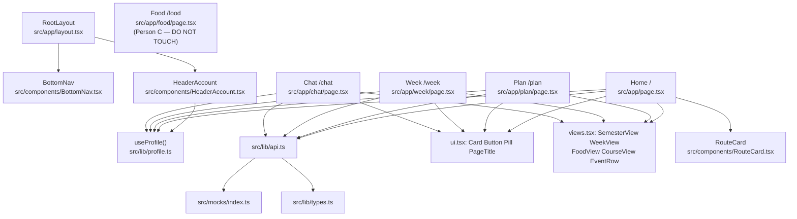
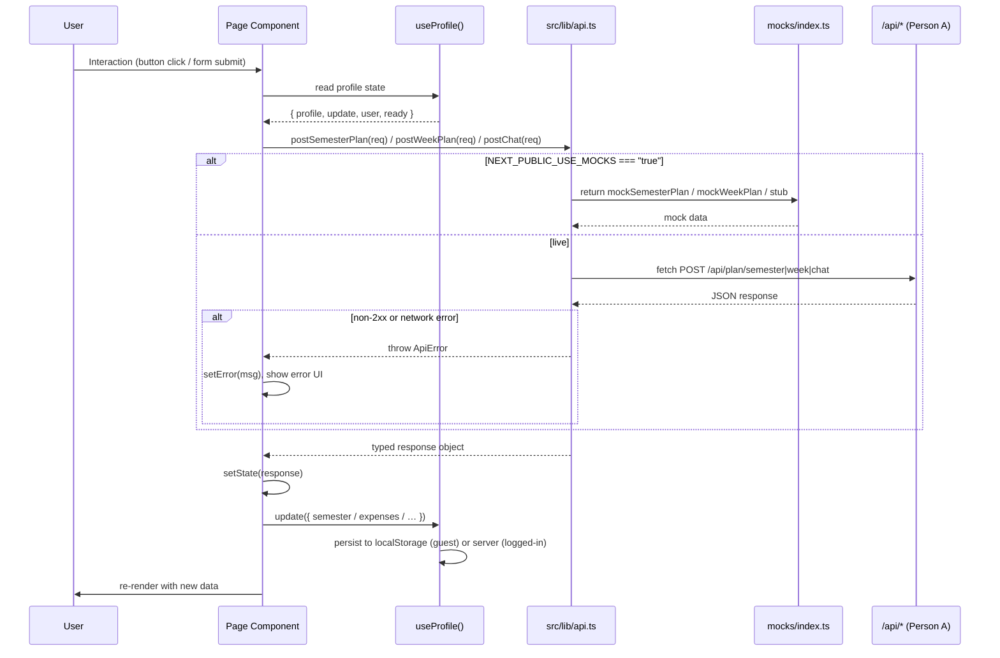

# Design Document: Rhett Frontend

## Overview

Rhett is a mobile-first Next.js 15 Progressive Web App for Boston University students. The frontend is a pure client-side shell rendered inside a shared `RootLayout` that provides a sticky BU-red header and a fixed `BottomNav`. Five page routes (`/`, `/plan`, `/week`, `/food`, `/chat`) are each independent `"use client"` components that share typed primitives from `src/components/ui.tsx`, consume data via `src/lib/profile.ts` (localStorage + server sync), and make all API calls through a single typed client module `src/lib/api.ts`. Mock data from `src/mocks/index.ts` short-circuits every network call when `NEXT_PUBLIC_USE_MOCKS=true`, enabling fully offline development and testing. Person A owns all `src/app/api/` routes and `src/lib/types.ts`; Person C owns `src/app/food/page.tsx`. This document covers only Person B's frontend scope.

---

## Architecture

### Shell Layout

```
Browser viewport
└── <html>
    └── <body>
        ├── <header> sticky top, bg-bu          ← RootLayout
        │   └── max-w-md: Logo + HeaderAccount
        ├── <main> max-w-md px-4 pt-4 pb-28     ← RootLayout
        │   └── {children}  ← page route
        └── <BottomNav> fixed bottom-0           ← RootLayout
            └── 5 tabs: Home Plan Week Food Chat
```

All page content is constrained to `max-w-md` centered horizontally. The `pb-28` on `<main>` prevents the BottomNav from obscuring the last card. The BottomNav inner `<ul>` adds `pb-[env(safe-area-inset-bottom)]` for iOS home-indicator clearance.

### Component Dependency Diagram



### Data-Flow Sequence Diagram



---

## Components and Interfaces

### Existing Components Reused Unchanged

| Component | File | Used by pages |
|---|---|---|
| `Card` | `src/components/ui.tsx` | All pages |
| `Button` | `src/components/ui.tsx` | Plan, Week, Chat |
| `Pill` | `src/components/ui.tsx` | Plan, Week, Chat, Views |
| `PageTitle` | `src/components/ui.tsx` | Plan, Week |
| `SemesterView` | `src/components/views.tsx` | Home (via chat cards), Plan, Chat |
| `WeekView` | `src/components/views.tsx` | Home (via chat cards), Week, Chat |
| `FoodView` | `src/components/views.tsx` | Chat |
| `CourseView` | `src/components/views.tsx` | Chat |
| `EventRow` | `src/components/views.tsx` | Home |
| `RouteCard` | `src/components/RouteCard.tsx` | Home |
| `HeaderAccount` | `src/components/HeaderAccount.tsx` | Layout |
| `BudgetView` | `src/components/BudgetView.tsx` | Chat |

### New Components to Create

#### `HomeSchedulePreview`

Proposed file: inline in `src/app/page.tsx` (private to the file).

```typescript
interface HomeSchedulePreviewProps {
  /** null = still loading; [] = loaded but empty; WeekEvent[] = has events */
  today: WeekEvent[] | null;
  error: string | null;
  currentMinutes: number;
}
```

Renders four states:
1. **Loading** (`today === null`): `<p className="text-sm text-zinc-400">Planning your day…</p>`
2. **Error** (`error !== null`): `<Card className="text-sm text-red-600">{error}</Card>`
3. **Empty** (loaded, `upcoming.length === 0`): `<Card className="text-sm text-zinc-500">Nothing else today. Enjoy the evening.</Card>`
4. **Events**: `<ul>` of up to 5 `<EventRow>` items filtered to `end > currentMinutes` and sorted ascending by `start`.

#### `QuickActionGrid`

Proposed file: inline in `src/app/page.tsx` (private to the file).

```typescript
interface QuickActionTile {
  href: string;
  title: string;
  /** Max 60 characters */
  body: string;
}

interface QuickActionGridProps {
  tiles: QuickActionTile[];
}
```

Renders a `grid grid-cols-2 gap-3` of Next.js `<Link>` cards. Each tile is a `<Link>` with `rounded-2xl border border-zinc-200 bg-white p-4 shadow-sm transition hover:border-bu`. The `body` is truncated at render time if it exceeds 60 characters (the constant array enforces this at compile time).

#### `PlanCourseChecklist`

Proposed file: inline in `src/app/plan/page.tsx` (private to the file).

```typescript
interface PlanCourseChecklistProps {
  major: Major;
  completed: Set<string>;
  offSheet: string[];
  onToggle: (code: string) => void;
}
```

Renders the per-term pill grid extracted from the current `PlanPage`. Each term section shows a `<p>` term label and a flex-wrap row of toggleable pill buttons. Completed courses use `border-bu bg-bu text-white`; not-completed use `border-zinc-300 bg-white text-zinc-700`. Off-sheet completed courses are rendered with a `×` dismiss button. No internal state — pure rendering from props.

#### `WeekPrefsForm`

Proposed file: inline in `src/app/week/page.tsx` (private to the file).

```typescript
interface WeekPrefsFormProps {
  prefs: WeekPrefs;
  onChange: (patch: Partial<WeekPrefs>) => void;
}
```

Renders the 2-column grid of wake-time, sleep hours, study hours, gym days, and gym minutes inputs extracted from `WeekPage`. Enforces min/max constraints at the input level AND in the `onChange` handler before calling `props.onChange`:

| Field | min | max | step |
|---|---|---|---|
| `sleepHours` | 0.5 | 24 | 0.5 |
| `studyHoursPerDay` | 0.5 | 24 | 0.5 |
| `gymDaysPerWeek` | 0 | 7 | 1 |
| `gymMinutes` | 15 | 240 | 15 |

The `wakeTime` field uses `<input type="time">` with `fromInputTime`/`toInputTime` helpers; no numeric min/max needed.

#### `WeekToDoList`

Proposed file: inline in `src/app/week/page.tsx` (private to the file).

```typescript
interface WeekToDoListProps {
  tasks: WeekPrefs["tasks"];
  onRemove: (index: number) => void;
  onAdd: (task: { name: string; minutes: number; timesPerWeek: number }) => void;
}
```

Renders the existing to-do list and add-task row. The "+" button is disabled when `name.trim()` is empty. `minutes` is clamped to 1–480; `timesPerWeek` is clamped to 1–7 before calling `onAdd`. Manages its own local draft state (`name`, `minutes`, `timesPerWeek`).

#### `ChatBubble`

Proposed file: inline in `src/app/chat/page.tsx` (private to the file).

```typescript
interface ChatBubbleProps {
  role: "user" | "assistant";
  content: string;
}
```

User messages: right-aligned `<div>` wrapping a `<p>` with `max-w-[85%] rounded-2xl rounded-br-sm bg-bu px-3 py-2 text-sm text-white`.  
Assistant messages: full-width `<p>` with `whitespace-pre-wrap rounded-2xl rounded-bl-sm bg-white px-3 py-2 text-sm shadow-sm`. Strips `**` from assistant content (existing behavior preserved).

#### `ChatCards`

Proposed file: inline in `src/app/chat/page.tsx` (private to the file).

```typescript
interface ChatCardsProps {
  cards: ChatCard[];
}
```

Renders a `<div className="mt-2 space-y-2">` dispatching each card by `kind`:

| kind | Component |
|---|---|
| `"semester"` | `<SemesterView plan={c.data} />` |
| `"week"` | `<WeekView plan={c.data} />` |
| `"food"` | `<FoodView data={c.data} />` |
| `"budget"` | `<BudgetView summary={c.data} />` |
| `"expense"` | Green confirmation pill: `✓ Logged $X.XX at Merchant (Category)` |
| `"course"` | `<CourseView course={c.data} />` |

---

## Data Models

### `ApiError` class (`src/lib/api.ts`)

```typescript
export class ApiError extends Error {
  constructor(
    public readonly status: number,
    message: string,
  ) {
    super(message);
    this.name = "ApiError";
  }
}
```

### API Client Function Signatures (`src/lib/api.ts`)

```typescript
import type {
  ChatRequest, ChatResponse,
  SemesterPlanRequest, SemesterPlanResponse,
  WeekPlanRequest, WeekPlanResponse,
} from "@/lib/types";
import { mockSemesterPlan, mockWeekPlan } from "@/mocks/index";

const USE_MOCKS = process.env.NEXT_PUBLIC_USE_MOCKS === "true";

async function post<TReq, TRes>(path: string, body: TReq): Promise<TRes> {
  const res = await fetch(path, {
    method: "POST",
    headers: { "Content-Type": "application/json" },
    body: JSON.stringify(body),
  });
  if (!res.ok) {
    throw new ApiError(res.status, `${path} responded ${res.status}`);
  }
  return res.json() as Promise<TRes>;
}

export async function postSemesterPlan(
  req: SemesterPlanRequest,
): Promise<SemesterPlanResponse> {
  if (USE_MOCKS) return Promise.resolve(mockSemesterPlan);
  return post<SemesterPlanRequest, SemesterPlanResponse>("/api/plan/semester", req);
}

export async function postWeekPlan(
  req: WeekPlanRequest,
): Promise<WeekPlanResponse> {
  if (USE_MOCKS) return Promise.resolve(mockWeekPlan);
  return post<WeekPlanRequest, WeekPlanResponse>("/api/plan/week", req);
}

export async function postChat(
  req: ChatRequest,
): Promise<ChatResponse> {
  if (USE_MOCKS) {
    return Promise.resolve({ reply: "Mock reply — mocks are enabled.", cards: [], engine: "rules" });
  }
  return post<ChatRequest, ChatResponse>("/api/chat", req);
}
```

No `any` types appear in any signature or internal implementation. No new npm dependencies are introduced; only the browser-native `fetch` API is used.

### Notes for Person A — `src/lib/types.ts` gaps (DO NOT edit `types.ts`)

1. **`WeekPlanRequest.weekOf`**: The client in `src/app/page.tsx` currently passes `weekOf: ""` (empty string) when building the home-page week plan. The type declares `weekOf: string` (ISO date). Person A should confirm whether the server substitutes the current week when `weekOf` is empty, or whether the client must always supply a valid ISO date string.

2. **`ChatRequest.profile`**: `profile` is typed `Profile | undefined`. Person A should document whether an absent or undefined `profile` causes the server to use a default context or return a 4xx error, so the chat page can handle the failure path correctly.

---

## Correctness Properties

*A property is a characteristic or behavior that should hold true across all valid executions of a system — essentially, a formal statement about what the system should do. Properties serve as the bridge between human-readable specifications and machine-verifiable correctness guarantees.*

### Property 1: BottomNav active-tab mutual exclusion

*For any* pathname string, exactly one tab in `BottomNav` receives the `text-bu` active class and every other tab receives `text-zinc-500`.

**Validates: Requirements 6.3, 6.4**

### Property 2: Completed-courses toggle idempotency

*For any* array of completed course codes and any course code string, toggling the code twice (add then remove, or remove then add) returns an array that is set-equivalent to the original.

**Validates: Requirements 2.5**

### Property 3: Chat turn ordering invariant

*For any* sequence of N complete user-send cycles (where each cycle appends one user turn then one assistant turn), the `turns` array has length exactly 2N and the role at index `i` is `"user"` when `i` is even and `"assistant"` when `i` is odd.

**Validates: Requirements 4.4**

### Property 4: Ask Rhett navigation guard

*For any* string composed entirely of whitespace characters (spaces, tabs, newlines), submitting the Ask Rhett form on the Home Dashboard must not invoke `router.push`.

**Validates: Requirements 1.3**

### Property 5: API client mock bypass consistency

*For any* valid `SemesterPlanRequest`, `WeekPlanRequest`, or `ChatRequest`, when `NEXT_PUBLIC_USE_MOCKS` is `"true"`, the corresponding `postSemesterPlan`, `postWeekPlan`, or `postChat` call must resolve successfully and the global `fetch` must not have been called.

**Validates: Requirements 8.6, 8.7, 8.8**

---

## Error Handling

### Common Try/Catch/Finally Pattern

All pages use the same pattern for API calls:

```typescript
const [loading, setLoading] = useState(false);
const [error, setError] = useState<string | null>(null);

const doFetch = async () => {
  setLoading(true);
  setError(null);
  try {
    const result = await postXxx(req);
    setResult(result);
  } catch (err) {
    const msg = err instanceof ApiError
      ? `Server error (${err.status}). Please try again.`
      : "Could not reach the server. Check your connection.";
    setError(msg);
  } finally {
    setLoading(false);
  }
};
```

The `finally` block ensures the loading spinner always clears, even after an error.

### Per-Page Error State Table

| Page | Trigger | User-visible result |
|---|---|---|
| Home `/` | `/api/plan/semester` POST fails on mount | Loading state clears; error message shown in "Rest of today" section; no navigation |
| Home `/` | `/api/plan/week` POST fails on mount | Loading state clears; error message shown in "Rest of today" section |
| Plan `/plan` | `GET /api/majors` fails | Major `<select>` stays empty; silent (non-critical path) |
| Plan `/plan` | `GET /api/majors?id=` fails | Course checklist not rendered; silent |
| Plan `/plan` | `POST /api/plan/semester` fails | "Build my plan" re-enabled; error message below button; completed courses preserved |
| Plan `/plan` | `GET /api/courses?q=` fails | Dropdown stays hidden; search input remains editable |
| Week `/week` | `POST /api/plan/week` fails | "Plan my week" re-enabled; error message shown below button |
| Week `/week` | `POST /api/week.ics` fails | Error message shown; displayed week plan is not disrupted |
| Week `/week` | `POST /api/extract-events` fails | "Find events" re-enabled; error or empty-state message shown |
| Chat `/chat` | `POST /api/chat` fails or 30s timeout | Assistant turn appended with "I couldn't reach the server. Try again?"; send button re-enabled |

### Chat 30-Second AbortController Timeout

```typescript
const send = async (text: string) => {
  if (!text.trim() || busy) return;
  const controller = new AbortController();
  const timer = setTimeout(() => controller.abort(), 30_000);
  setBusy(true);
  try {
    const res = await fetch("/api/chat", {
      method: "POST",
      headers: { "Content-Type": "application/json" },
      body: JSON.stringify({ messages: next.map(({ role, content }) => ({ role, content })), profile }),
      signal: controller.signal,
    });
    clearTimeout(timer);
    if (!res.ok) throw new ApiError(res.status, "chat failed");
    const data: ChatResponse = await res.json();
    // ... process data
  } catch {
    clearTimeout(timer);
    setTurns([...next, { role: "assistant", content: "I couldn't reach the server. Try again?" }]);
  } finally {
    setBusy(false);
  }
};
```

Note: `postChat` in `src/lib/api.ts` does not accept an `AbortSignal` directly; the Chat page calls `fetch` directly for this endpoint to support the timeout, or `postChat` is extended to accept an optional `signal` parameter (additive change, no type breakage).

---

## Testing Strategy

### Property-Based Tests (fast-check)

`fast-check` must be added as a dev dependency (`npm install --save-dev fast-check`). Each property test runs a minimum of 100 iterations.

| Property | Test file | Generator description |
|---|---|---|
| P1: BottomNav mutual exclusion | `src/components/BottomNav.test.tsx` | `fc.string()` for pathname; render with React Testing Library; assert exactly one `.text-bu` child in the nav |
| P2: Completed-courses toggle idempotency | `src/app/plan/planToggle.test.ts` | `fc.array(fc.string())` for initial completed; `fc.string()` for code; call toggle twice; assert set-equality |
| P3: Chat turn ordering | `src/app/chat/chatTurns.test.ts` | `fc.array(fc.record({ content: fc.string() }), { minLength: 1, maxLength: 20 })` for N send operations; simulate append pairs; assert length = 2N, role alternates |
| P4: Whitespace navigation guard | `src/app/homeNav.test.ts` | `fc.string().filter(s => s.trim() === "")` for whitespace strings; assert `router.push` is never called |
| P5: Mock bypass | `src/lib/api.test.ts` | `fc.record({ majorId: fc.string(), ... })` for each request type; spy on global `fetch`; assert `fetch` not called when `USE_MOCKS = true` |

Tag format for each test: `// Feature: rhett-frontend, Property N: <property text>`

Example:
```typescript
// Feature: rhett-frontend, Property 1: BottomNav active-tab mutual exclusion
it.prop([fc.string()])("exactly one active tab for any pathname", (pathname) => {
  // ...
});
```

### Unit Tests

| Test | File |
|---|---|
| `HomeSchedulePreview` renders loading state when `today === null` | `src/app/page.test.tsx` |
| `HomeSchedulePreview` renders empty state when upcoming events = 0 | `src/app/page.test.tsx` |
| `HomeSchedulePreview` shows at most 5 events, sorted by start ascending | `src/app/page.test.tsx` |
| `postSemesterPlan` sets `Content-Type: application/json` header | `src/lib/api.test.ts` |
| `postSemesterPlan` throws `ApiError` on 500 response | `src/lib/api.test.ts` |
| `postWeekPlan` throws `ApiError` on 404 response | `src/lib/api.test.ts` |
| `BottomNav` renders exactly 5 tabs | `src/components/BottomNav.test.tsx` |
| `BottomNav` tab 4 links to `/food` and is labeled "Food" | `src/components/BottomNav.test.tsx` |
| Plan page shows "No courses found" when `GET /api/courses` returns `[]` | `src/app/plan/page.test.tsx` |
| Plan page "Use this as my semester" shows "Saved ✓" when plan equals `profile.semester` | `src/app/plan/page.test.tsx` |
| Chat input accepts at most 500 characters | `src/app/chat/page.test.tsx` |
| Chat page auto-sends `?q=` param exactly once on mount | `src/app/chat/page.test.tsx` |
| `WeekPrefsForm` clamps `gymMinutes` to 15–240 | `src/app/week/page.test.tsx` |
| `WeekToDoList` "+" button is disabled when `name.trim()` is empty | `src/app/week/page.test.tsx` |

### Integration / Example Tests

| Test | Notes |
|---|---|
| Home page with mocks renders greeting and 5 tiles without API calls | Uses `NEXT_PUBLIC_USE_MOCKS=true` |
| Plan page with mocks renders `mockSemesterPlan` without API calls | Uses `NEXT_PUBLIC_USE_MOCKS=true` |
| Week page with mocks renders `mockWeekPlan` without API calls | Uses `NEXT_PUBLIC_USE_MOCKS=true` |
| Chat page suggestion chip sends message on single click | React Testing Library interaction |
| `/food` route renders without a runtime error | Smoke; defers to Person C's page content |
| Manifest fields: name, short_name, theme_color, background_color, icons, display, start_url | Read and parse `public/manifest.webmanifest` |
| Layout `<head>` contains `<link rel="manifest">` | Next.js metadata integration |

---

## File Changes

### Files to Modify

| File | What changes |
|---|---|
| `src/components/BottomNav.tsx` | Replace `{ href: "/money", label: "Money", icon: "money" }` tab with `{ href: "/food", label: "Food", icon: "food" }`; add `aria-hidden="true"` to each `<svg>` icon (the tab `<Link>` text provides the accessible label); ensure each `<Link>` renders at min `h-[44px]` or `py-3` so the tap target meets 44 px; add `aria-label` to the `<svg>` element describing destination if the text label alone is insufficient per WCAG. |
| `src/app/page.tsx` | Switch API calls to use `postSemesterPlan`/`postWeekPlan` from `src/lib/api.ts`; add `error` state and display it in the "Rest of today" section; extract `HomeSchedulePreview` and `QuickActionGrid`; add whitespace guard on Ask Rhett form submit; sort upcoming events ascending by `start`; add mock-bypass branch using `NEXT_PUBLIC_USE_MOCKS`. |
| `src/app/plan/page.tsx` | Switch `fetch` calls to `postSemesterPlan` from `src/lib/api.ts`; add `error` state and display it below the "Build my plan" button; add "No courses found" empty-state to the course search dropdown; extract `PlanCourseChecklist`; wrap plan build in `try/catch/finally` to re-enable the button on failure. |
| `src/app/week/page.tsx` | Switch `fetch` calls to `postWeekPlan` from `src/lib/api.ts`; add `error` state for the plan build and ICS download separately; extract `WeekPrefsForm` and `WeekToDoList` with min/max range enforcement; wrap build and downloadIcs in `try/catch/finally`; add error UI for ICS failure that does not remove the displayed plan. |
| `src/app/chat/page.tsx` | Switch to `postChat` from `src/lib/api.ts` or use `fetch` directly with `AbortController` for the 30-second timeout; add 500-character `maxLength` to the input; add `ChatBubble` and `ChatCards` components; treat `AbortError` the same as a network failure. |

### Files to Create

| File | Purpose |
|---|---|
| `src/lib/api.ts` | Typed fetch wrappers (`postSemesterPlan`, `postWeekPlan`, `postChat`); `ApiError` class; mock-bypass logic gated on `NEXT_PUBLIC_USE_MOCKS`; no `any` types; no new npm dependencies. |

### Files to Verify — No Changes

| File | Current status | Notes |
|---|---|---|
| `public/manifest.webmanifest` | ✅ Correct — `name`, `short_name`, `theme_color`, `background_color`, `icons`, `display`, and `start_url` all match Requirements 9.1–9.4 | No changes needed |
| `public/icon.svg` | ✅ Non-empty SVG; BU-red `#cc0000` rounded square with white "R"; referenced in manifest as `/icon.svg` with `"sizes": "any"` and `"type": "image/svg+xml"` | No changes needed |
| `src/app/layout.tsx` | ✅ `metadata.manifest` set to `"/manifest.webmanifest"`; `appleWebApp: { capable: true, title: "Rhett", statusBarStyle: "default" }` present; `viewport.themeColor` set to `"#cc0000"` | No changes needed |
| `src/app/food/page.tsx` | **DO NOT TOUCH** — owned by Person C | Navigation to `/food` is handled solely by the BottomNav "Food" tab. If this file does not exist yet, the route returns a 404 until Person C delivers it; that is acceptable per Requirement 5.2. |

### Coordination Notes for Person A

- **`src/lib/types.ts` — `WeekPlanRequest.weekOf`**: The home page currently passes `weekOf: ""` (empty string). The type declares `string` (ISO date). Person A should confirm whether the server accepts an empty string and substitutes the current week, or requires a valid ISO date. Until clarified, the home page will continue to pass `""` and `src/app/week/page.tsx` will pass a real ISO date (next Monday).

- **`src/lib/types.ts` — `ChatRequest.profile`**: Typed as `Profile | undefined`. Person A should document whether an absent profile triggers a server-side default or a 4xx error, so the Chat page can handle the failure path correctly.

---

## Accessibility Design

### WCAG AA Contrast

All text on BU-red (`#cc0000`) backgrounds uses white (`#ffffff`). The contrast ratio is approximately 5.9:1, which exceeds the 4.5:1 requirement for normal-weight text and the 3:1 requirement for large text. This applies to the sticky header, `bg-bu` buttons, active BottomNav tabs, and any user chat bubbles.

### Label Associations

Every `<input>`, `<select>`, and `<textarea>` on all pages must be associated with either a `<label htmlFor="...">` or an `aria-label` attribute. The current codebase uses inline `<label>` wrappers in most places — this pattern is correct. Inputs that use a `<span>` inside a `<label>` wrapper (e.g., `WeekPrefsForm`, `PlanPage`) are correctly associated because the `<input>` is a descendant of `<label>`.

### ARIA Usage

- `BottomNav` SVG icons: `aria-hidden="true"` on each `<svg>`; the visible tab label text provides the accessible name. No additional `aria-label` on the `<svg>` is needed when `aria-hidden` is set.
- Loading states: use `role="status"` and `aria-live="polite"` on the loading paragraph so screen readers announce when the state changes.
- Error messages: use `role="alert"` on error paragraphs so screen readers announce errors immediately.
- Busy buttons: use the HTML `disabled` attribute (not just visual styles) so assistive technologies announce the disabled state.

### Disabled Attribute Discipline

All "disabled during loading" buttons must set the HTML `disabled` attribute, not merely change CSS classes. React's `disabled={loading}` on `<button>` elements satisfies this requirement. The existing pattern in `Button` and inline buttons already uses `disabled` correctly.

### Focus Management

- After the Ask Rhett form submits and navigates to `/chat`, focus lands on the chat input (the Chat page's `<input>` is rendered immediately).
- After a course search result is selected from the dropdown (Plan page), focus returns to the search input (`setExtra(""); input.focus()` — the implementation should call `.focus()` on the input ref after selection).
- The Chat page sticky input bar uses `sticky bottom-20` positioning, keeping it visible above the BottomNav without removing it from the DOM order.

### DOM Order

Each screen's focusable elements follow a top-to-bottom, left-to-right order matching the visual layout:
- **Home**: greeting → Ask Rhett form → RouteCard (starting-from select) → Rest of today → quick-action tiles
- **Plan**: major select → term select → standing select → course pills → search input → search results → build button → SemesterView → "Use this as my semester" button
- **Week**: fixed events list → textarea → "Find events" button → preferences form → to-do list → add-task row → "Plan my week" button → WeekView → "Add to Calendar" button
- **Chat**: suggestion chips (when empty) → conversation → "Rhett is thinking…" → message input → send button

---

## Mobile Layout

### Shell Standards

- All page content uses `max-w-md` (448 px) centered with `mx-auto`.
- `<main>` has `px-4` horizontal padding and `pb-28` bottom padding to clear the BottomNav (approximately 80 px tall) plus an extra safety margin.
- The sticky header has `z-20`; the BottomNav has `z-20` and `fixed inset-x-0 bottom-0`.
- The Chat input bar uses `sticky bottom-20` so it floats above the BottomNav.

### Card Style Standards

All card-like surfaces use the `Card` component: `rounded-2xl border border-zinc-200 bg-white p-4 shadow-sm`. Inner cards (e.g., `CourseView`) use `!p-3` to override the default padding. Never use raw `<div>` with ad-hoc border/shadow styles for card containers.

### Scroll Behavior

- The Chat page uses a `useEffect` with `bottom.current?.scrollIntoView({ behavior: "smooth" })` to scroll to the latest turn after every state update.
- The Week page `WeekView` uses `overflow-x-auto` on the day-tab row for horizontal scroll on narrow screens.
- The Plan page's course search dropdown uses `max-h-40 overflow-y-auto` to prevent the results list from pushing content off screen.
- No page uses `overflow-hidden` on the body or `<main>`; scrolling is handled naturally by the document.

### Touch Targets

All interactive elements meet the 44 px minimum touch target height:
- `Button` component: `py-3` = 12 px × 2 + font ≈ 44 px.
- `BottomNav` links: `py-2` + icon + label ≈ 44 px; verify and increase to `py-3` if measured below 44 px.
- Pill toggle buttons on Plan page: `px-2.5 py-1` is below 44 px visually but acceptable since they are grouped in a flex-wrap grid (the overall interactive zone is padded by neighboring elements). If stricter compliance is needed, increase to `py-2`.
- Course search dropdown items: `py-1.5` ≈ 38 px; increase to `py-2` for full compliance.
